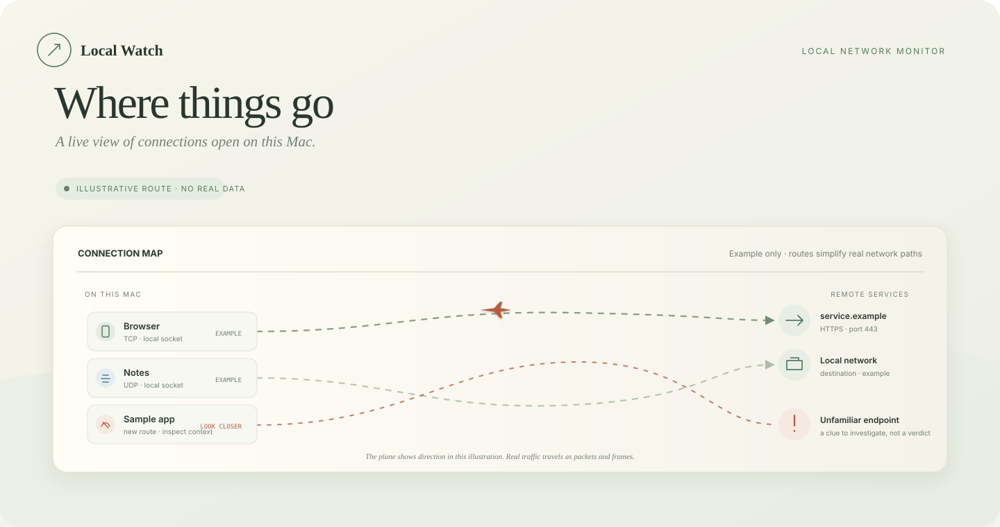

# Local Network Watcher



*Illustrative UI artwork with synthetic labels, not a live snapshot from a specific Mac.*

*A live view of connections open on this Mac.*

Site: <https://tanya-ok.github.io/local-network-watcher/> · Security: [SECURITY.md](SECURITY.md)

Local Network Watcher is a local-first macOS network observatory. It shows open process-to-endpoint connections, process-level traffic counters, connection changes, a live route diagram, and selected packet fields from an optional TShark capture. It is designed to help people understand and investigate network activity; a new connection or unusual pattern is a prompt to inspect, not proof of malicious behavior.

## Run

Requires macOS, Rust 1.85 or newer and Node.js 20 or newer. The collector that reads sockets and traffic is written in Rust; the small local web server is Node.js. One command builds the collector and starts the server:

```sh
npm start
```

Open <http://127.0.0.1:4317>. The server binds to loopback only. Set `PORT` to use another local port.

## What it observes

- Connection snapshots are refreshed every three seconds from `lsof`; process byte and packet totals come from `nettop` and are not attributed to individual sockets. The optional process inventory is assembled from `ps` and `nettop`; the checkbox can include zero-valued processes visible in that snapshot. This is not guaranteed to equal every row Activity Monitor can show. The connection map remains limited to observed open remote sockets.
- **Process traffic** lists 25 entries per page. Processes with a non-zero current rate appear first, followed by the highest observed rate. Search and the “include processes with no network counters” option apply to the full snapshot before paging.
- The server samples every 15 seconds to build a local baseline. It stores process names, destination groups, ports, and timestamps in `~/Library/Application Support/LocalWatch/history.json` with restrictive file permissions. The Settings view can delete this history.
- Reverse DNS requests use the Mac's configured resolver. Selecting an external address for owner details can run `whois` against a public registry. Those lookups leave the Mac; the app does not upload its packet capture or connection history.
- “First seen” and other attention markers describe what this local baseline observed. They are investigation cues, not threat verdicts.
- macOS may hide details for protected processes. Normal monitoring does not request administrator access.
- A user can request SIGTERM for a same-account process after a confirmation. This may close unsaved work and does not block network access. Restart and network isolation are not implemented.
- This version does not enforce firewall rules or identify a connection as malicious.

## Capture

The application can optionally capture decoded packet fields using TShark from an installed Wireshark app at `/Applications/Wireshark.app/Contents/MacOS/tshark`. The binary is a local dependency, not bundled with this repository. Capture is **off by default** and can be started from the **Capture** tab in the UI. A confirmation dialog explains that:

* TShark decodes selected frame, Ethernet, IP, TCP/UDP, DNS and TLS fields; packet payload and raw hex bytes are not requested,
* data stays **in the local app's memory** and is cleared by Clear, a new capture, or closing the page,
* capture data is not uploaded or written to a capture file by this app.

Capture runs for a configurable duration (5, 10 or 30 seconds; default 10) and stops after at most 3000 packets. Only one capture may run at a time. An optional Wireshark display filter (`-Y`, for example `dns` or `tcp.port == 443`) limits which decoded packets TShark returns to the UI; the short live capture can still observe packets that do not match the filter. The separate search box is plain text over displayed fields, not a display filter. Process names in the packet table are best-effort matches by local port against the current connection snapshot, not kernel-level packet attribution. Permission to capture depends on this Mac's Wireshark/dumpcap setup; invalid filters and TShark errors are shown in the tab.

## Map and explanations

- **Map**: apps on the left, destinations on the right. Lines show live connections; after a capture their width follows captured bytes. Names can come from reverse DNS and from TLS server names seen in a capture.
- Click a line, app or destination to open its inspector. The selected route stays highlighted while the live map refreshes.
- **Security**: review local baseline markers, inspect a process's signature, parent chain, folder and sockets, and request SIGTERM after confirmation. Stopping a process does not block its network traffic.
- **Map console**: guided commands for live connections, process inspection, temporary TShark capture, local model questions and stopping a process. It is not a general-purpose shell. `restart` is intentionally unavailable until the app can verify how each process should be relaunched.
- **Flight Map**: choose one currently open connection and follow its process, socket, transport, interface, next-hop gateway and remote endpoint. Process names, socket endpoints and macOS route lookup are real local observations. Intermediate internet routers and the remote socket are outside this laptop's view. Process traffic totals are aggregate counts, not per-socket measurements. Click a stop for a plain explanation and its exact evidence.
- **Map and Flight Map visuals**: the route plane and airport language are original reading aids. Animated paths do not claim to be packet-level traces. Packet evidence appears only after a TShark capture.
- **Owner lookup**: selecting a destination runs `whois` for that address. This asks the public internet registry about the address.
- **Explain with local AI**: sends the selected facts to Ollama on this Mac (`127.0.0.1:11434`, default `gemma4:26b`, override with `EXPLAIN_MODEL`). It does not call a cloud model.
- **Network console AI**: `models` lists locally installed Ollama models; `ask <question>` uses the configured model and, when one is selected, only that connection's process and endpoint fields.
- **Layers**: a selected packet shows a simple OSI explanation and expandable TShark-decoded fields. This is a curated field view, not Wireshark's complete protocol tree. The app does not decrypt TLS or show raw packet bytes. Plain-text protocol metadata, including some HTTP details, may be visible.

## License and authorship

Local Network Watcher is open source under the MIT License. Copyright and license notices must be retained in copies or substantial portions. The app credits its author, Tanya Babitskaya.

## Attention markers

The server samples connections every 15 seconds, also while the page is closed, and learns what is normal for 24 hours. After that it marks, with one plain sentence: an app online for the first time, a new destination for an app, an unusual port, night activity (00:00 to 06:00) from an app that is rarely online then, and a sudden traffic burst. "Looks normal" silences a marker for good.

History holds metadata only (app names, destination groups by reverse-DNS domain or network block, ports, times), never packet contents. It lives in `~/Library/Application Support/LocalWatch/history.json` (folder `0700`, file `0600`). Settings has a button to delete it. `LOCAL_WATCH_DATA` and `LOCAL_WATCH_LEARNING_HOURS` override the folder and the learning period.
